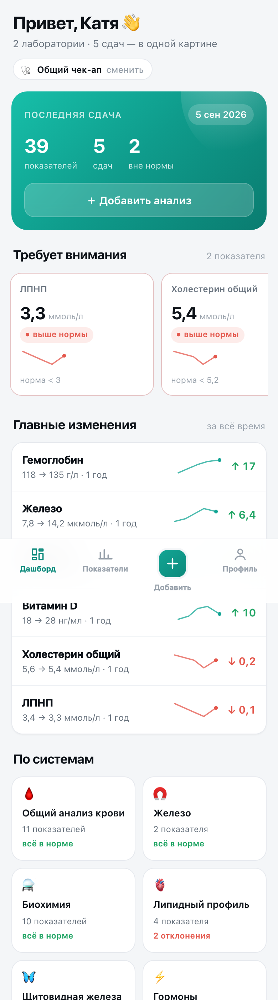

# Динамика — мини-апп для анализов

Telegram Mini App, который собирает анализы из разных лабораторий в один дневник: находит одинаковые показатели в разных бланках, строит графики и показывает референсные значения.



## Что умеет

- **Принимает бланки**: PDF, фото и скриншоты (можно несколько сразу), вставленный текст, ручной ввод.
- **Сопоставляет показатели** из разных лабораторий по коду: «Гемоглобин», «HGB» и «Hb» — один показатель.
- **Считает норму под человека**: пол, возраст и цель (волосы, беременность, кардио, спорт). У каждой границы виден источник.
- **Строит графики** с зоной референса.
- **Поясняет** показатели человеческим языком.
- **Отдаёт данные**: CSV со значениями и референсами.

## Быстрый старт

```bash
npm install
npm start
```

Открой адрес, который напечатает сервер (по умолчанию `http://127.0.0.1:3000`), — приложение поднимется с демо-историей.

Проверить загрузку бланка: в папке `samples/` лежит `lab-invitro.pdf`.

## Как это работает

```
PDF/фото ──► текст ──► строки-показатели ──► каталог кодов ──► ряд по датам ──► график
                                             (синонимы)        (общий для всех)
```

- `server/parser.js` — разбор бланков.
- `server/catalog.js` — 56 показателей: коды, синонимы, тексты, нечёткое сопоставление.
- `server/references.js` — нормы по полу, возрасту и цели + источники.
- `server/aggregate.js` — ряды, статусы, изменения, сводка.
- `server/store/` — Postgres (Neon) или SQLite.
- `webapp/` — интерфейс без сборки: роутер, SVG-графики, тема Telegram.

## Референсы

Приоритет: правило по цели/возрасту/полу → референс из бланка → базовый диапазон.

| Показатель | Поправка | Источник |
| --- | --- | --- |
| Гемоглобин | возраст, беременность | ВОЗ, 2024 |
| Ферритин | волосы от 40, беременность от 30 | ВОЗ, 2020 + практика |
| Витамин D | дефицит ниже 20 нг/мл | Endocrine Society, 2024 |
| ТТГ | беременность до 2,5 | ATA, 2017 |
| ЛПНП, холестерин | кардио: ЛПНП до 1,8 | ESC/EAS, 2019 |
| СРБ | кардио: до 3 мг/л | AHA/CDC, 2003 |
| Глюкоза, HbA1c | кардио: до 5,6 | ADA, 2025 |

Слабые места помечены честно: «практика» вместо «рекомендация».

## Названия из разных лабораторий

Словарь синонимов + нечёткое сопоставление (опечатки, лишние слова, единицы) + обучение: если название незнакомое, показатель выбирается вручную в экране проверки и запоминается.

## Данные

По умолчанию SQLite. Для продакшена — Postgres (Neon) через `DATABASE_URL`. Схема создаётся сама.

| Переменная | Зачем |
| --- | --- |
| `PORT` | Порт (по умолчанию 3000) |
| `BOT_TOKEN` | Токен бота; включает проверку Telegram |
| `WEBAPP_URL` | HTTPS-адрес мини-аппа |
| `DATABASE_URL` | Postgres (Neon) |
| `DATABASE_PATH` | Путь к SQLite, если Postgres не задан |

## Деплой

Пошагово — в [DEPLOY.md](DEPLOY.md).

## Ограничения

- OCR работает только на macOS (Apple Vision). На Linux фото не читаются, PDF и текст работают.
- Приложение не ставит диагнозы — это дневник наблюдений.
